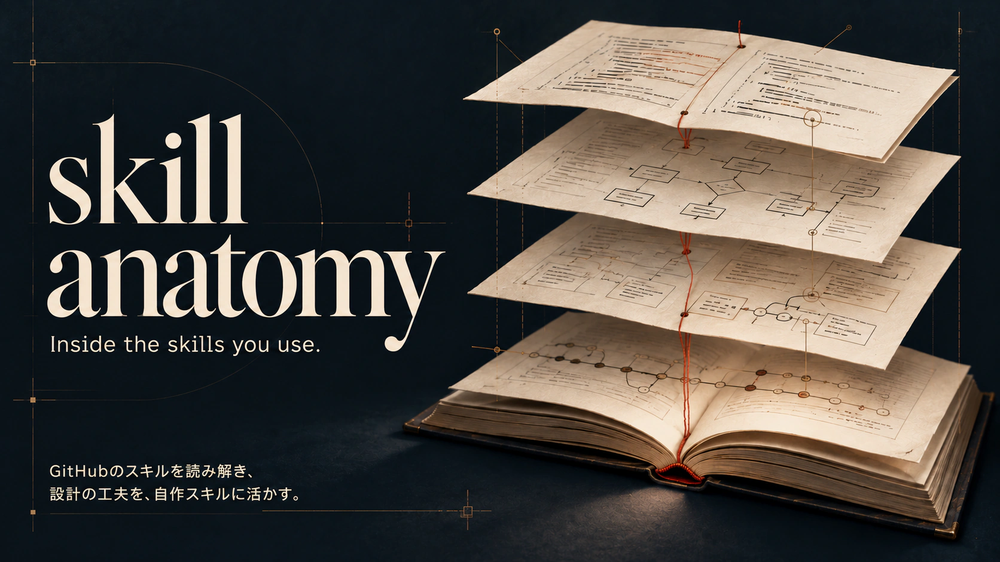

# Skill anatomy

[English](README.md) | 日本語



お気に入りのスキルの仕組みを知り、自分のスキル作成に活かすための、AIエージェント向けスキルです。

GitHub上のスキルのURLを渡すと、仕組みや設計の工夫、自作への応用を日本語のレポートにまとめます。

[Skill anatomy自身の分析例](examples/skill-anatomy.md)は、2026年10月28日に[コミット`61d695d`](https://github.com/yamazaki-yuki-23/skill-anatomy/tree/61d695d94dba7fcd5824f113b85ff07e114220e8)を対象として、このスキルで生成しました。本文は生成結果で、レビュー後に出典の行番号3件だけを補正しています。[grill-meの分析](examples/grill-me.md)は、2026年10月22日に調べた過去の例として残し、再生成していません。

## はじめる

Node.js 22以上とGitが必要です。

1. 次のどちらかでスキルをインストールします。使うエージェントとインストール先は、実行時に選べます。

   ```sh
   # インストール
   npx skills add yamazaki-yuki-23/skill-anatomy

   # 更新
   npx skills update skill-anatomy
   ```

   GitHub CLIを使う場合

   ```sh
   # インストール
   gh skill install yamazaki-yuki-23/skill-anatomy skill-anatomy

   # 更新
   gh skill update skill-anatomy
   ```

2. エージェントを再起動し、調べたいGitHubのURLを渡します。

   Codexの場合

   ```text
   $skill-anatomy https://github.com/mattpocock/skills
   ```

   Claude Codeの場合

   ```text
   /skill-anatomy https://github.com/mattpocock/skills
   ```

3. 提示された調査範囲と保存先を確認し、「OK」と返します。スキルごとのレポートが順に保存され、最後にリポジトリ全体のレポートが作られます。

リポジトリ全体でも、[1つのスキル](https://github.com/mattpocock/skills/tree/main/skills/productivity/grill-me)でも、URLから調査範囲を自動で判別します。複数のスキルを含むフォルダや、`SKILL.md` ファイルのURLも指定できます。

PR・Issueも調べる場合は、GitHub CLIをインストールし、`gh auth login` で認証してください。利用できない場合もファイルとコミットを調べ、取得できなかった情報をレポートに記載します。

## レポートで分かること

- 作者がどんな課題に向き合い、どの変更で対処したか。
- 指示の順序や確認のタイミング、参照資料の使い分けが、エージェントの判断をどう変えるか。
- 学んだ設計を別の課題へ応用するとき、どんな条件や指示が必要か。

使い方を知ることに加えて、「なぜこの指示でうまく進むのか」「自分ならどう設計するか」を考えるために作りました。URLと一緒に「参照資料とSKILL.mdの役割分担を詳しく」など、知りたいことも伝えられます。指定した重点は、対応する章の調査・説明に反映します。調査の境界や他の章の完成基準は維持し、答えられなかった問いは未確認の範囲へ残します。完了済みレポートに追加の調査が必要なら、`--refresh` を案内します。

説明には出典を付け、作者自身の説明と、分析による解釈を区別します。動機が分からない部分は、その旨を記載します。調査対象は指定リポジトリ内のファイル・コミット・PR・Issueです。調べるスキルの実行や採点は行いません。

## 保存されるファイル

レポートは、次の優先順位で選ばれたフォルダの `reports/` に保存されます。

1. `SKILL_ANATOMY_WORKSPACE` で指定したフォルダ。
2. Git cloneしたSkill anatomyを使う場合は、そのcloneのルート。
3. それ以外は、分析を実行している作業フォルダ。

たとえば、別の作業フォルダから `skill-anatomy/` のcloneを使うと、環境変数の指定がなければ `skill-anatomy/reports/` に保存されます。インストールしたコピーはスキルのフォルダ外で使います。既定の保存先なら、レポートはインストール先と分かれ、更新後も残ります。

```text
reports/<所有者>/<リポジトリ名>/
├── repository-analysis.md      # リポジトリ全体のレポート
├── skill-analyses/<パス>.md     # スキルごとのレポート
└── .state.json                 # 再開に使う記録
```

全体のレポートには、スキルの一覧と共通する設計の工夫をまとめます。各スキルの仕組みや経緯、応用例は、スキルごとのレポートに記載します。全体のレポートからリンクをたどって読めます。対象が1つなら、全体のレポートは調べた範囲と個別分析への案内を中心にし、詳しい具体例は繰り返しません。

見出しと順序は、全体のレポートとスキルごとのレポートでそれぞれ統一しています。複数のスキルを調べたときも、使い方・経緯・設計・応用例を同じ場所で探せます。

対象に評価やテストの資料があれば、入力・期待出力・失敗条件を設計の根拠として読み解きます。評価やテストは実行せず、定義や説明用の例を実測結果として扱いません。

応用先に自分のスキルを使う場合は、本文を貼り付けるか、読むローカル通常ファイルを明示してください。応用章で、その課題・当てはめる設計・変える点と理由を説明します。指定ファイル内の参照先や隣接ファイルは自動取得せず、自作スキルを編集・実行しません。読んだ資料と不足は調査記録に残します。応用先の変更は自動検知しないため、完了済みレポートの追加調査には `--refresh` を使います。

全体分析の完了後、エージェントが `reports/index.md` に設計・適用条件・出典レポート・調査日・分析コミットをまとめます。保存先は開始時に提示して承認に含めます。他のレポートの行は保持し、一覧の更新は分析の再開判定に影響しません。過去のレポートは明示指定したものだけを取り込み、自動探索しません。共有一覧を同時更新しないでください。

## 続きから調べる・調べ直す

同じURLをもう一度渡すと、未完了のスキルと、ソースや共有の参照資料の変更が影響するスキルを調べます。PR・Issueの索引だけが更新された場合は完了済み本文を保持し、`discussion_updates` と警告で、議論の更新が未確認であることを知らせます。警告は明示的な再調査が完了するまで残ります。議論を反映するには `--refresh` で指定範囲を調べ直してください。索引は全件取得を維持します。

前回も今回もGitHub索引を取得できない場合は、ソースと保存レポートに変更がなければ完了済みの分析を再利用します。PR・Issueの更新は確認できていないため、CLIはその制約を毎回警告し、新規分析ではレポートの調査範囲にも取得できなかった情報を残します。索引を再び取得できた場合や、取得できていた索引が取得不能になった場合は、全スキルを再調査します。強制的に調べ直すには `--refresh` を使います。

次のオプションは、URLの後ろに付けます。

| オプション | 動作 |
|---|---|
| `--no-confirm` | 調査開始前の確認を、今回だけ省く。ツールの権限確認は省かない |
| `--refresh` | 指定した範囲をすべて調べ直す |

<details>
<summary>保存先の変更と、再実行時の注意</summary>

CLIを直接使う場合は、`status PLAN` で選択対象ごとの `pending` / `done`、全体分析の `repository.status`、完了件数の `done` / `total` を確認できます。`PLAN` には最新の `prepare` が返した `plan_file` を指定してください。個別の状態は完了記録を示し、ソースや個別レポートを変更した場合の再判定には `prepare` を使います。個別分析が再調査対象になった場合や個別の完成記録を更新した場合は、古い全体分析の完了記録を無効化し、改めて全体分析の完成を記録するまで `pending` を保ちます。

保存先を変える場合は、エージェントを起動する前に設定します。

```sh
export SKILL_ANATOMY_WORKSPACE="$HOME/.local/share/skill-anatomy"
```

CLIを直接使う場合は、`prepare URL --workspace "/path/to/analysis"` で今回のレポートとキャッシュの保存先を指定できます。環境変数や既定の保存先より優先します。スキルのインストール先ではなく、保存用のフォルダを指定してください。旧オプション `--tool-root` は移行先を示すエラーになります。

同名のスキルは元のパスで区別します。元のスキルが削除されても、過去のレポートは残ります。レポートと `.state.json` は一緒にGitで管理できます。同じリポジトリの調査を、同じ保存先で同時に実行しないでください。

`prepare`・`approve`・`complete` は、同じリポジトリの状態ファイルを別プロセスが更新中なら、`.state.json.lock` のエラーで止まります。ロックは各コマンドの実行中だけ有効で、エージェントによるレポート本文の保存までは保護しません。異なるリポジトリは別のロックを使います。

異常終了後にロックが残った場合は、次の手順で回復します。

1. エラーに表示されたロックファイルを読み、`hostname`・`pid`・`created_at` を確認します。同じ保存先を使うすべての端末で、該当リポジトリのコマンドを停止してください。PIDの再利用があるため、PIDだけでは実行者を判断しません。
2. 記録されたホストを含め、使用中のプロセスがないことを確認した場合だけ、ファイル管理画面でロックを未使用の名前へ変更して保全します。例は `.state.json.lock.recovered-20261028-090000` です。実行状態が不明なら変更しないでください。
3. コマンドを再実行します。再びロックエラーなら別の実行が始まっていないか確認します。`.state.json` やPLANは削除しません。

ロックは通常終了・例外時に解放します。経過時間やPIDからの自動回復は行わず、回復用の待機時間も設けません。

`prepare` の保存に成功すると、同じリポジトリの古い計画ディレクトリを整理します。最新のPLANと索引、再開状態、レポート、他リポジトリの計画は残ります。中断後も最新PLANで続けられ、再度 `prepare` すると現在の完了状態を引き継いだ新しいPLANを返します。削除対象は、同じ保存先に対応する旧PLANと索引だけを含む生成済みの `run-*` に限ります。追加ファイル・壊れたPLAN情報・シンボリックリンクがあるものは残し、整理に失敗した場合は警告します。

PRレビューだけの変更など、自動検知できない更新もあります。調べ直したい場合は `--refresh` を指定してください。

</details>

レポートの書き方は [i-have-adhd](https://github.com/ayghri/i-have-adhd/blob/main/skills/i-have-adhd/SKILL.md)（答えを先に、手順は番号で、成果は具体的に）と [yomiyasu](https://github.com/nanaism/yomiyasu/blob/main/skills/yomiyasu/SKILL.md)（意味と断定の強さを保って推敲する）の工夫を参考にしました。

[MIT License](LICENSE)
