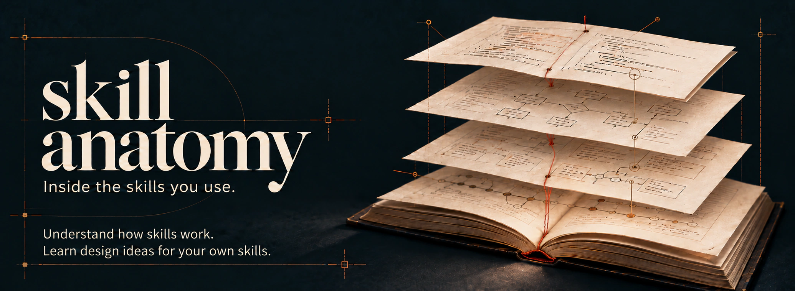

# Skill anatomy

English | [日本語](README.ja.md)

Understand how your favorite agent skills work. Pass the URL of a skill on GitHub and get a Japanese report on the problems its author faced, how the skill works, and why it was designed that way.

## Get started

Requires Node.js 22 or later and Git. To include pull requests and issues, also install the GitHub CLI and run `gh auth login`.

1. Install the skill. Choose your agent and installation location when prompted.

   ```sh
   npx skills add yamazaki-yuki-23/skill-anatomy
   ```

   With the GitHub CLI, `gh skill install yamazaki-yuki-23/skill-anatomy skill-anatomy` works as well.

2. Restart your agent and pass the GitHub URL you want to study.

   ```text
   /skill-anatomy https://github.com/mattpocock/skills
   ```

   In Codex, write `$skill-anatomy` instead of `/skill-anatomy`.

3. Check the proposed research scope and output location, then reply "OK". The agent saves a report for each skill as it works, then a report on the repository as a whole, under `reports/` in the output location it proposed (by default the directory you run the analysis in; see [Saved files](#saved-files)).

The URL decides the scope: a whole repository, one skill, a folder of skills, or a `SKILL.md` file. An `.html` file with the same content is saved beside each Markdown report for reading in a browser. Update later with `npx skills update skill-anatomy` or `gh skill update skill-anatomy`.

## What you get



Each skill report follows one real example from the repository from input to output, separates the author's stated reasons from what the files and history show, and explains each important design decision as the question it answers, the options the sources show, and the reason for the choice. When the repository has no example, the report says so instead of inventing one. The repository report lists the skills and the design they share. Every report uses the same headings in the same order, cites its sources at a fixed commit, and marks unknown motivations as unverified. Target skills are never executed or scored.

Read the [approved sample report](examples/yomiyasu/skill-analyses/yomiyasu.md) and the [other examples](examples/README.md) to see the result. The analysis methods and writing rules live in the skill's [references](skills/skill-anatomy/references/), and the provenance of the methods in [docs/analysis-methods.md](docs/analysis-methods.md).

You can add a question alongside the URL, such as "explain how responsibilities are split between SKILL.md and its references"; the relevant sections then go deeper on it.

## Saved files

```text
reports/<owner>/<repository>/
├── repository-analysis.md      # Report on the repository as a whole
├── repository-analysis.html    # Its HTML version
├── skill-analyses/<path>.md     # Report on each skill
├── skill-analyses/<path>.html   # Its HTML version
└── .state.json                 # Record of completed reports
```

`reports/` is created in the first applicable location: the directory set in `SKILL_ANATOMY_WORKSPACE`; otherwise the root of the Skill anatomy Git clone when the skill is loaded from that clone, whatever directory you run the analysis in; otherwise the directory where you run the analysis. Installed copies must be run from outside the skill directory, and with the default location their reports survive updates. To choose another location, set the variable before starting your agent:

```sh
export SKILL_ANATOMY_WORKSPACE="$HOME/.local/share/skill-anatomy"
```

## Repeat research

Pass the same URL again to research the selected scope again from the current commit. Every selected report is rewritten, and reports for skills outside the selection are kept. Within one session the agent continues an interrupted analysis from the skills that are not yet complete.

| Option | Behavior |
|---|---|
| `--no-confirm` | Skip research-plan confirmation for this run. Tool permission prompts still apply. |

<details>
<summary>Using the CLI directly, locks, and cleanup</summary>

The agent drives `node skills/skill-anatomy/dist/cli.js` (`--help` lists the commands). `prepare URL` pins the commit, expands its files into `.cache/sources/<owner>/<repo>/<commit>/` with an index of paths, byte counts and line counts, fetches the issue index, and returns the PLAN; `prepare URL --workspace PATH` overrides the output location for one run. `approve PLAN` records your OK. `status PLAN` shows each skill's `pending` / `done` state, the repository state, and each HTML version's presence and check result. `complete PLAN --skill PATH` or `--repository` records completion, generates the HTML version from the Markdown using the templates in `assets/templates/` (edit their `<style>` to change the look), and returns `report_bytes` with `warnings` when a skill analysis exceeds 20,000 bytes or the Markdown uses notation the HTML version cannot carry. `discussion PLAN --number N` fetches an issue or pull request with its comments, reviews and changed files in one call. HTML versions are not part of the completion record.

`prepare`, `approve` and `complete` stop with a `.state.json.lock` error while another process updates the same repository state. If a lock remains after an abnormal exit, read the lock file named in the error, check its `hostname`, `pid` and `created_at`, make sure no process on any machine sharing the output location is still running, then rename the lock to an unused name and run the command again. There is no automatic recovery. Do not research the same repository concurrently in the same output location.

A successful `prepare` removes superseded plan directories for the same repository, keeping the latest PLAN, the completion record, the reports and other repositories' plans; directories with extra files, malformed PLAN metadata or symbolic links are preserved. Skills with the same name are distinguished by their original paths, and reports for deleted skills are retained. You can track `reports/` including `.state.json` in Git.

</details>

The report style borrows from [i-have-adhd](https://github.com/ayghri/i-have-adhd/blob/main/skills/i-have-adhd/SKILL.md) (answer first, numbered steps, concrete results) and [yomiyasu](https://github.com/nanaism/yomiyasu/blob/main/skills/yomiyasu/SKILL.md) (revise while keeping meaning and the strength of claims).

[MIT License](LICENSE)
