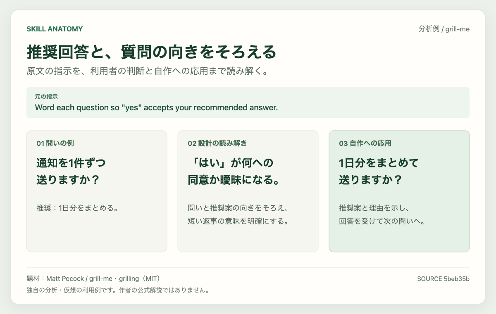

# Skill anatomy

English | [日本語](README.ja.md)

Learn how the agent skills you use are designed.

Give your agent a GitHub URL. It reads the instructions, references, and history, then writes a Japanese Markdown guide to the problem, the mechanism, the design decisions, and ideas for your own skills. Works with Codex and Claude Code.

[](examples/grill-me.md)

Example: [a guide to grill-me, in Japanese](examples/grill-me.md). An independent analysis of [Matt Pocock's skill](https://github.com/mattpocock/skills/tree/main/skills/productivity/grill-me). The questions in the image are hypothetical examples.

## Get started

Requires Node.js 22 or later and Git.

1. Install the skill. Choose your agent and installation scope when prompted.

   ```sh
   npx skills add yamazaki-yuki-23/skill-anatomy
   ```

2. Restart your agent and pass the GitHub URL you want to study.

   Codex:

   ```text
   $skill-anatomy https://github.com/mattpocock/skills
   ```

   Claude Code:

   ```text
   /skill-anatomy https://github.com/mattpocock/skills
   ```

3. Check the proposed research plan and output location, then reply “OK”. The agent saves individual analyses as it works and finishes with a guide to the repository's shared design ideas.

Repositories, individual skills, and folders containing multiple skills are detected automatically. You can also pass an [individual skill URL](https://github.com/mattpocock/skills/tree/main/skills/productivity/grill-me) or a URL ending in `blob/REF/PATH/SKILL.md`.

To include pull requests and issues, install the GitHub CLI and authenticate with `gh auth login`. If it is unavailable, analysis continues with files and commits, and missing information is noted.

## What you learn

Using a skill you like can raise questions: why do these instructions work this way, and how would you design something similar? Skill anatomy was built to explore those questions through source files and history.

- What problem the author faced, and which changes addressed it.
- How instruction order, approval points, and shared references shape the agent's decisions.
- What conditions and instructions you would need to apply the same idea to a different problem.

You can add a focus alongside the URL, such as “explain how the shared interview procedure is separated from its entry points”.

Explanations cite their sources and distinguish the author's statements from the analyst's interpretation. Unknown motivations are identified. Research stays within the target repository's files, commits, pull requests, and issues. Target skills are not executed or scored.

## Reports

Reports are saved in the directory where you run the analysis.

```text
reports/<owner>/<repository>/
├── repository-analysis.md      # Overview, skill list, and shared design lessons
├── skill-analyses/<path>.md     # Each skill's mechanism, history, design, and applications
└── .state.json                 # Resume state
```

Each guide follows the structure that suits the skill. The repository guide links to individual analyses, so you can choose what to study.

Run the same URL again to resume unfinished work and reanalyze items affected by changes. Changes to shared files or the pull request and issue index may trigger reanalysis of all skills.

| Option | Behavior |
|---|---|
| `--no-confirm` | Skip research-plan confirmation for this run. Tool permission prompts still apply. |
| `--refresh` | Reanalyze the entire selected scope. |

<details>
<summary>Output location and reruns</summary>

To choose another location, set this variable before starting your agent:

```sh
export SKILL_ANATOMY_WORKSPACE="$HOME/.local/share/skill-anatomy"
```

Skills with the same name are distinguished by their original paths. Reports for deleted skills are retained. You can track reports and `.state.json` together in Git. Do not analyze the same repository concurrently.

Some updates, such as changes limited to PR reviews, may go undetected. Use `--refresh` when you want to research them again.

</details>

## Update

```sh
npx skills update skill-anatomy
```

With the installation above, reports are stored outside the installed skill and survive updates.

[MIT License](LICENSE)
