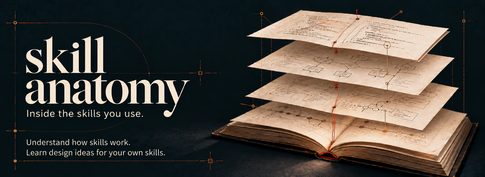

# Skill anatomy

English | [日本語](README.ja.md)



Understand how your favorite agent skills work, and apply what you learn to your own.

Pass the URL of a skill on GitHub to get a Japanese report on how it works, its design decisions, and ideas for your own skills.

See the [analysis of Skill anatomy itself, in Japanese](examples/skill-anatomy.md), for an example report.

## Get started

Requires Node.js 22 or later and Git.

1. Install the skill with either command. Choose your agent and installation location when prompted.

   ```sh
   # Install
   npx skills add yamazaki-yuki-23/skill-anatomy

   # Update
   npx skills update skill-anatomy
   ```

   Or use the GitHub CLI:

   ```sh
   # Install
   gh skill install yamazaki-yuki-23/skill-anatomy skill-anatomy

   # Update
   gh skill update skill-anatomy
   ```

2. Restart your agent and pass the GitHub URL you want to study.

   Codex:

   ```text
   $skill-anatomy https://github.com/mattpocock/skills
   ```

   Claude Code:

   ```text
   /skill-anatomy https://github.com/mattpocock/skills
   ```

3. Check the proposed research scope and output location, then reply "OK". The agent saves a report for each skill as it works, followed by a report on the repository as a whole.

The URL determines the research scope: a whole repository, [one skill](https://github.com/mattpocock/skills/tree/main/skills/productivity/grill-me), a folder containing several skills, or a `SKILL.md` file.

To include pull requests and issues, install the GitHub CLI and authenticate with `gh auth login`. If it is unavailable, research continues with files and commits, and missing information is noted in the report.

## What the reports explain

- What problem the author faced, and which changes addressed it.
- How instruction order, approval points, and the division of responsibilities across references shape the agent's decisions.
- What conditions and instructions you would need to apply a design idea to a different problem.

Skill anatomy was built to explore why a skill's instructions work the way they do, and how you might design your own. You can add a question alongside the URL, such as "explain how responsibilities are split between SKILL.md and its references". Your focus guides research and explanation in the relevant sections. Research boundaries and the other completion criteria still apply; unanswered questions remain in the unverified scope. If a completed report needs additional research, the agent explains how to use `--refresh`.

Explanations cite their sources and distinguish the author's statements from the analyst's interpretation. Unknown motivations are identified. Research stays within the target repository's files, commits, pull requests, and issues. Target skills are not executed or scored.

## Saved files

Reports are saved under `reports/` in the first applicable location:

1. The directory set in `SKILL_ANATOMY_WORKSPACE`.
2. The root of the Skill anatomy Git clone, when using the skill from that clone.
3. Otherwise, the directory where you run the analysis.

For example, using a clone at `skill-anatomy/` from another directory saves reports to `skill-anatomy/reports/` unless the variable is set. Run installed copies from outside the skill directory. With the default location, their reports remain separate and survive skill updates.

```text
reports/<owner>/<repository>/
├── repository-analysis.md      # Report on the repository as a whole
├── skill-analyses/<path>.md     # Report on each skill
└── .state.json                 # Record used to resume research
```

The repository report covers the skill list and shared design ideas. Each skill's report explains its mechanism, history, and applications. Links in the repository report lead to those reports. For a single skill, the repository report is a short guide to the researched scope and individual report; it does not repeat the detailed examples.

Each report type uses consistent headings in a fixed order, so you can find usage, history, design, and applications in the same place when comparing skills.

When evaluation or test materials are present, the analysis explains their inputs, expected outputs, and failure conditions as evidence for design choices. Evaluations and tests are not executed, and definitions or illustrative examples are not presented as measured results.

To apply the findings to your own skill, paste its contents or explicitly name the local regular files to read. The application section explains its problem, the design to apply, and what to change and why. References and neighboring files are not read automatically, and your skill is not edited or executed. The research record identifies the supplied material and gaps. Changes to application files are not detected automatically; use `--refresh` for additional research on a completed report.

After repository analysis completes, the agent updates `reports/index.md` with design ideas, application conditions, source reports, research dates, and analyzed commits. The index path is proposed before approval. Rows from other reports are preserved, and index changes do not affect analysis resume decisions. Older reports are imported only when explicitly selected; they are not discovered automatically. Do not update the shared index concurrently.

## Resume or repeat research

Pass the same URL again to research unfinished skills and those affected by source or shared-reference changes. If only the pull request and issue index changes, completed report content is retained, and `discussion_updates` plus a warning identify unverified discussion updates. The warning persists until explicit research completes. Use `--refresh` to research the selected scope and incorporate discussions. The full index is still acquired.

If the GitHub index is unavailable on both runs, completed analyses are reused when their sources and saved reports are unchanged. Pull request and issue updates remain unverified, so the CLI warns on every run, and new analyses record the missing information in their research scope. All skills are researched again when index access returns or a previously available index becomes unavailable. Use `--refresh` to force research again.

Add these options after the URL:

| Option | Behavior |
|---|---|
| `--no-confirm` | Skip research-plan confirmation for this run. Tool permission prompts still apply. |
| `--refresh` | Research the entire selected scope again. |

<details>
<summary>Change the output location and understand reruns</summary>

When calling the CLI directly, use `status PLAN` to see each selected skill's `pending` / `done` state, the repository analysis's `repository.status`, and the `done` / `total` count. Pass the `plan_file` from the latest `prepare` as `PLAN`. Individual states are completion records; run `prepare` to reassess changes to sources or individual reports. When individual research becomes pending or an individual completion record is updated, the old repository completion record is invalidated and stays `pending` until you record repository completion again.

To choose another location, set this variable before starting your agent:

```sh
export SKILL_ANATOMY_WORKSPACE="$HOME/.local/share/skill-anatomy"
```

When calling the CLI directly, use `prepare URL --workspace "/path/to/analysis"` to choose where this run saves reports and caches. This overrides the environment variable and default location. Choose a storage directory outside the installed skill. The former `--tool-root` option returns an error explaining how to migrate.

Skills with the same name are distinguished by their original paths. Reports for deleted skills are retained. You can track reports and `.state.json` together in Git. Do not research the same repository concurrently in the same output location.

`prepare`, `approve`, and `complete` stop with a `.state.json.lock` error if another process is updating the same repository state. Locks cover each CLI command, including repository acquisition during `prepare`; they do not cover agents writing report content. Different repositories use separate locks.

If a lock remains after an abnormal exit, recover it as follows:

1. Read the lock file named in the error and check its `hostname`, `pid`, and `created_at`. Stop commands for that repository on every machine sharing the output location. A PID alone does not identify the owner because operating systems reuse PIDs.
2. Only after confirming that no process is using it, including on the recorded host, preserve the lock by renaming it to an unused name in your file manager, such as `.state.json.lock.recovered-20261028-090000`. Leave it unchanged if execution status is unknown.
3. Run the command again. If it reports a lock again, check for another run. Keep `.state.json` and PLAN files.

Locks are released on normal completion and exceptions. There is no automatic recovery based on age or PID, and no recovery waiting period.

After successfully saving a new preparation, `prepare` removes superseded plan directories for the same repository. It retains the latest PLAN and index, resume state, reports, and other repositories' plans. You can continue an interrupted analysis with the latest PLAN; another `prepare` returns a new PLAN carrying the current completion state. Cleanup only removes generated `run-*` directories containing exactly the old PLAN and index for the same state file. Extra files, malformed PLAN metadata, and symbolic links are preserved; cleanup failures produce a warning.

Some updates, such as changes limited to PR reviews, may go undetected. Use `--refresh` when you want to research them again.

</details>

[MIT License](LICENSE)
