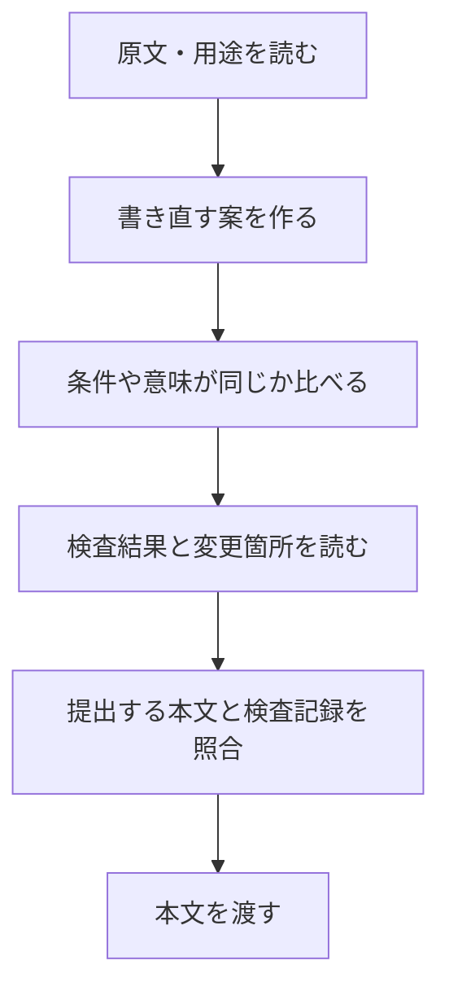

# yomiyasu の分析

## 概要と使い方

`yomiyasu`は、AIが書いた日本語を、元の意味を保ちながら読みやすく直すスキルです。

学べるのは、**直したい表現を探すだけでなく、変えてはいけない意味も確かめる手順**です。

「yomiyasuで、この案内文を読みやすくして」のように、対象の文章と一緒に頼みます。通常は書き直した本文、変更理由、必要な質問、検査記録を返します。「本文だけ」と頼んだ場合は本文だけです。参照資料があれば、事実を確かめる材料にも使います。検査にはPythonを使います。[使う条件と出力形式][entry]が明記されています。

## 仕組みと処理の流れ

次は、本分析で作った仮想例です。

> 原文：担当者の確認後に限り、設定を変更できます。
> 依頼：この案内を短く、読みやすくして。



1. 文章の用途と読者を確認し、必要な[補足資料][audience]だけを読みます。原文の表現も先に検査します。
2. 言い換え案を作り、主張、誰が何をするか、条件、数値などを原文と比べます。この例なら「担当者の確認後」という条件を残します。
3. 最終稿を別ファイルに保存し、[検査をまとめるコード][runner]で表現と原文との差を調べます。指摘と変更箇所を読み、直す場合は1回にまとめて再検査します。
4. 提出直前に、[照合のコード][verify]で、提出する本文が検査済みの本文と同じかを確かめます。ここで本文を変えたら再検査が必要です。

`SKILL.md`が判断と順序を指定し、参照資料が文章の種類ごとの注意点を補います。Pythonのコードは、表現の候補、変更箇所、検査の記録を扱います。**意味が同じか、読みやすいかを最後に判断するのは、原文を読む人です。** [検査の限界][limits]にも、この役割分担が書かれています。

## 作成・変更の経緯

作者は[README][background]で、禁止表現の置き換えを強めると、別の不自然な文章になる問題を説明しています。そこで重視するのが、元の意味と文のつながりです。

| きっかけ | 対応と、その根拠 |
|---|---|
| 検査で指摘がなくても、気になる表現が残る | [Issue #1への作者の返答][issue1]では、検査範囲より広い保証に読める表示を改めたと説明しています。 |
| 検査した後の本文まで確認したい | [v2.0.0の変更][v2diff]で、別々だった検査をまとめる処理と、提出直前の照合を追加しました。[PR #21][pr21]では通常の点数表示も外したと説明しています。 |

本分析では、これを「表現の指摘に加えて、意味と提出物を確かめる手順を整えた変化」と読み取ります。現在の対象はv2.5.0です。

## 設計判断と学べること

### 言い換える前に、残す意味を決める

短くすると、条件や約束まで消えることがあります。そこでyomiyasuは、案を原文と比べ、意味が変わるなら案を捨てて原文を残します。気に入る案が出るまで作り直す手順にはしていません。[言い直しの手順][rephrase]に、この判断が書かれています。

たとえば「管理者の場合だけ削除できる」を「削除できる」にすると、利用できる人の条件が消えます。これは参照資料にもある例です。**書き方は変えたいが、条件は変えられない文章**で使える考え方です。

### 指摘の少なさを、文章の良さにしない

指摘を消すための修正が、意味を変える場合もあります。yomiyasuの検査は、直すかどうかを考える場所を示します。

[テストの定義][pairs]では、「保存期間は3日です」を「保存期間は30日です」に変えたとき、数値の変化を候補として出すことを求めています。主語と相手の入れ替え、否定の変更も対象です。期待値は「意味を保てたと判定すること」ではなく、「見直す場所を示すこと」です。

[過去の比較資料][benchmark]にも、掲載した点数は現在の品質判定ではないと注意書きがあります。本分析でも、テストや点数の存在だけで読みやすさが実証されたとは扱いません。

### 検査した本文を、そのまま提出する

検査した後に一文を書き換えると、その一文は検査されていません。yomiyasuは[保存する記録][record]に最終稿の内容を表す値を入れ、提出前に照合します。

[照合のテスト][checktest]では、検査後に「31日」へ変更した本文を、変更済みとして扱うことを求めています。一方、記録が一致しても、文章の意味が正しいという判定にはなりません。[記録の説明][recordlimits]も、人の承認や改ざん防止の証明とは区別しています。

本分析では、これは**作ったものと検査したものの取り違えを防ぐ工夫**と読み取ります。ファイルや文章を最後に整えてから渡す作業に応用できます。

## 自作スキルへの応用

取り入れるなら、まず**「短くする前に、残す情報を決める」**です。

たとえば、会議メモを要約するスキルを作るとします。以下は本分析の仮想例です。

> 会議メモ：田中さんが来月の導入案を検討する。導入するかは未決定。
> 残す要約：田中さんが来月の導入案を検討。導入は未決定。
> 意味が変わる要約：田中さんが来月導入する。

`SKILL.md`には、次のように書けます。

```text
要約前に、決定事項・未決定事項・担当・期限を拾う。
要約後に、その情報が変わっていないか原文と比べる。
原文にない決定・担当・期限は加えない。不明なまま残す。
提出直前にも、確認した要約と同じ本文かを確かめる。
```

yomiyasuは文章の言い換えが中心ですが、要約では情報を省きます。そのため、文をすべて残す規則を移すのではなく、**省いてはいけない情報**を会議メモに合わせて決めます。何を省いてよいか決まっていない要約には、先にその基準が必要です。

## 調査範囲と出典

| 項目 | 内容 |
|---|---|
| 元URL | [nanaism/yomiyasu](https://github.com/nanaism/yomiyasu) |
| 分析コミット | `29d67ccb05e370b5958d72920a9cd1aa829dee80` |
| 調査日 | 2026-11-01 |
| 調査範囲 | `skills/yomiyasu/SKILL.md`、参照資料の関連箇所、検査・記録・照合のコード、README、検査の説明と限界、比較資料、関連テスト、Git履歴、Issue #1とPR #21の本文・コメント・レビュー。 |
| 未確認の範囲 | 全コード・全テストの網羅的確認、非公開の評価環境、利用環境ごとの動作。PR #49の本文は補足として読みましたが、評価値の再現確認はしていません。 |
| 実行検証 | なし。対象スキルや付属コードは実行していません。 |

本文は固定コミットのファイルに基づきます。Issue・PRの発言は変更理由の資料で、実行結果の再現確認とは分けています。架空の例と自作向けの指示は本分析で作成しました。この初稿1件から、分析手法の優位性までは判断しません。

[entry]: https://github.com/nanaism/yomiyasu/blob/29d67ccb05e370b5958d72920a9cd1aa829dee80/skills/yomiyasu/SKILL.md#L1-L23

[audience]: https://github.com/nanaism/yomiyasu/blob/29d67ccb05e370b5958d72920a9cd1aa829dee80/skills/yomiyasu/SKILL.md#L212-L251

[runner]: https://github.com/nanaism/yomiyasu/blob/29d67ccb05e370b5958d72920a9cd1aa829dee80/skills/yomiyasu/scripts/yomiyasu_check.py#L1715-L1790

[verify]: https://github.com/nanaism/yomiyasu/blob/29d67ccb05e370b5958d72920a9cd1aa829dee80/skills/yomiyasu/scripts/yomiyasu_check.py#L4088-L4120

[limits]: https://github.com/nanaism/yomiyasu/blob/29d67ccb05e370b5958d72920a9cd1aa829dee80/docs/limitations.md#L1-L5

[background]: https://github.com/nanaism/yomiyasu/blob/29d67ccb05e370b5958d72920a9cd1aa829dee80/README.md#L40-L77

[issue1]: https://github.com/nanaism/yomiyasu/issues/1#issuecomment-5955421604

[v2diff]: https://github.com/nanaism/yomiyasu/commit/c365f4d2219c59069cb8e6ae390a9601aeb9e241

[pr21]: https://github.com/nanaism/yomiyasu/pull/21

[rephrase]: https://github.com/nanaism/yomiyasu/blob/29d67ccb05e370b5958d72920a9cd1aa829dee80/skills/yomiyasu/references/rephrase-test.md#L5-L25

[pairs]: https://github.com/nanaism/yomiyasu/blob/29d67ccb05e370b5958d72920a9cd1aa829dee80/tests/test_v200_reproduce_pairs.py#L28-L53

[benchmark]: https://github.com/nanaism/yomiyasu/blob/29d67ccb05e370b5958d72920a9cd1aa829dee80/evals/comparison_benchmark.md#L1-L3

[record]: https://github.com/nanaism/yomiyasu/blob/29d67ccb05e370b5958d72920a9cd1aa829dee80/skills/yomiyasu/scripts/yomiyasu_check.py#L2698-L2763

[checktest]: https://github.com/nanaism/yomiyasu/blob/29d67ccb05e370b5958d72920a9cd1aa829dee80/tests/test_v200_check.py#L1085-L1095

[recordlimits]: https://github.com/nanaism/yomiyasu/blob/29d67ccb05e370b5958d72920a9cd1aa829dee80/docs/tools.md#L327-L361
